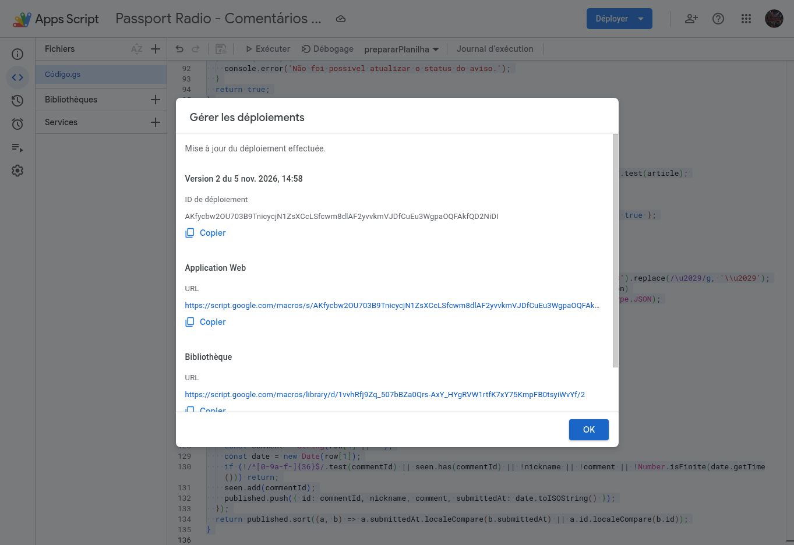
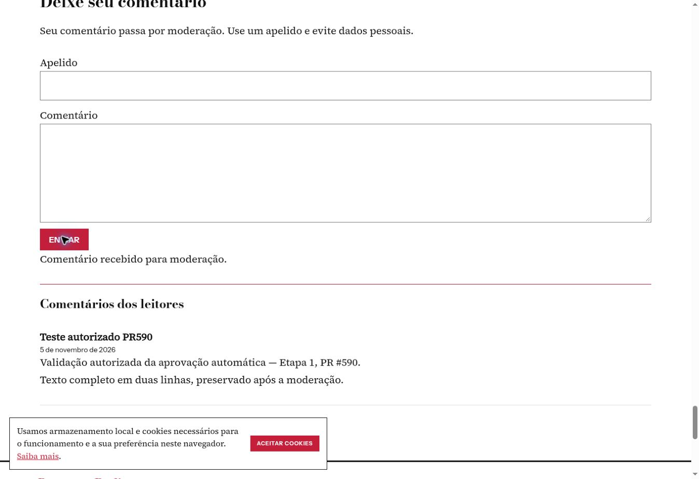
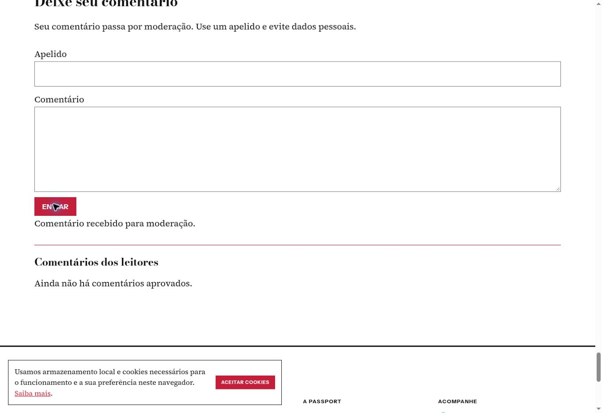
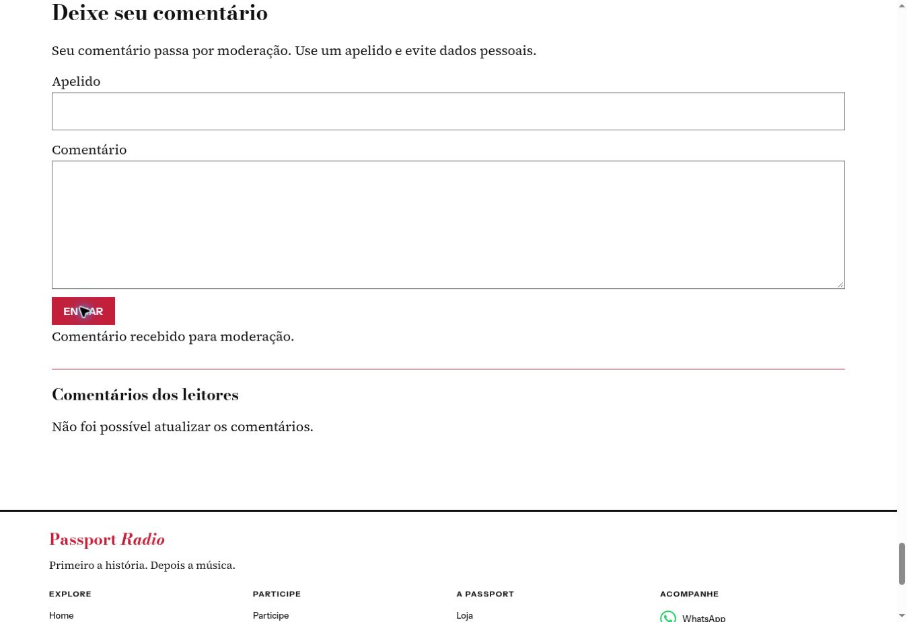

# Etapa 1 — comentários aprovados do Blog

Base: PR #589 mergeada, main 423b183dab04011c570fde016b4e57bb21c45f55. Branch: feat/blog-approved-comments-20261105.

## Implementação

Leitura anônima do Apps Script, limitada a APROVADO e URL canônica exata. Resposta contém somente ID, apelido, comentário integral e data. Cliente atualiza a cada 30 segundos e ao retornar à aba; renderiza texto literal, elimina IDs duplicados, substitui a lista e cancela leituras ao sair da matéria. PENDENTE e REJEITADO não são retornados. Rejeitar uma aprovação anterior retira o comentário na próxima leitura.

Contexto Blog preservado: /blog/w/ ou editorial com passport-area=blog. Notícias canônicas não recebem formulário nem lista de aprovados. doPost, envio, confirmação, deduplicação e Gmail preservados. Nenhum arquivo de áudio, Home, matéria, fotografia, vídeo ou navegação alterado.

## Verificações executadas

Em 05/11/2026, `node --test integrations/blog-comments/receiver.test.cjs integrations/blog-comments/approved.test.cjs`: 7 passaram, 0 falharam. Cobrem receptor existente, Gmail indisponível, deduplicação de envio, seleção de moderação e matéria, mudança PENDENTE → APROVADO → REJEITADO, campos privados ausentes, callback inválido, texto integral e escape de conteúdo. `node --check js/passport-blog-comments.js` passou.

## Ativação e teste real concluídos

Em 05/11/2026, após autorização explícita do proprietário para atualizar somente a implantação existente do Apps Script, foi salva a **versão 2**. O mesmo ID de implantação e o mesmo /exec foram preservados. A interface Google confirmou “Mise à jour du déploiement effectuée”. Código original de recebimento preservado integralmente; o acréscimo foi conferido como idêntico ao da PR. Planilha original privada, conta executora e acesso anônimo preservados. prepararPlanilha não foi executada novamente.

Teste real sem sessão Google via curl e leitura JSONP da prévia completa no Chrome:

| Verificação | Resultado |
| --- | --- |
| Novo envio depois da versão 2 | Confirmação visível; uma linha PENDENTE, aviso ENVIADO, uma mensagem Gmail |
| PENDENTE | Lista vazia no /exec e na página |
| Alteração somente da linha de teste para APROVADO | Apareceu automaticamente na matéria de Kurt, sem recarregar |
| Apelido | Teste autorizado PR590 |
| Texto | Integral, duas linhas preservadas |
| Data | 5 de novembro de 2026; datetime 2026-11-05T17:59:12.587Z |
| Duplicação na lista | Uma entrada |
| Consulta de outra matéria (Led Zeppelin) enquanto aprovado | Lista vazia |
| Alteração para REJEITADO | Entrada retirada automaticamente; lista vazia |

ID exclusivo do teste: `0241db50-1696-4498-83b2-fbca2a550067`. Apenas a célula de moderação dessa nova linha foi alterada, primeiro para APROVADO e depois REJEITADO. Estado final REJEITADO; nenhum comentário real anterior alterado. O público recebe somente campos permitidos dos aprovados da URL exata.

Teste real adicional: Home → Blog → matéria de Kurt → envio → Home. Somente passport-live-audio ativo, readyState 4, fonte OnlyLive preservada. Tempos observados: Home 79,98 s; Blog 91,29 s; matéria 99,17 s; após envio 132,17 s; retorno Home 199,40 s. O formulário confirmou recebimento. Linha de teste 276bbfd6-b59b-4a61-b9b0-590f3317df87 encontrada uma vez, PENDENTE e aviso ENVIADO. Gmail retornou uma mensagem para o ID. Nenhuma linha anterior modificada.

Notícias: a mesma matéria em URL canônica sem passport-area=blog apresentou zero formulários, zero listas públicas e zero scripts de leitura Google.

Prévia privada atualizada: https://passport-pr589-comments-preview.mr-nomad.chatgpt.site — versão da prévia 031936d3d2049a8096827d02f1834285a818a1a6. Acesso do proprietário preservado; site oficial intocado. Captura do envio confirmado: .

Etapa 1 implementada e validada com o Google real. Navegador disponível para a execução: Chrome; não se declara teste executado em Firefox. A prévia privada completa permanece acessível ao proprietário para sua conferência no Firefox. Nenhuma nova publicação da prévia foi necessária: ela já contém o leitor da PR. Sem merge, publicação do site oficial, alteração da main ou dos motores de áudio. A Etapa 2 não foi iniciada.
