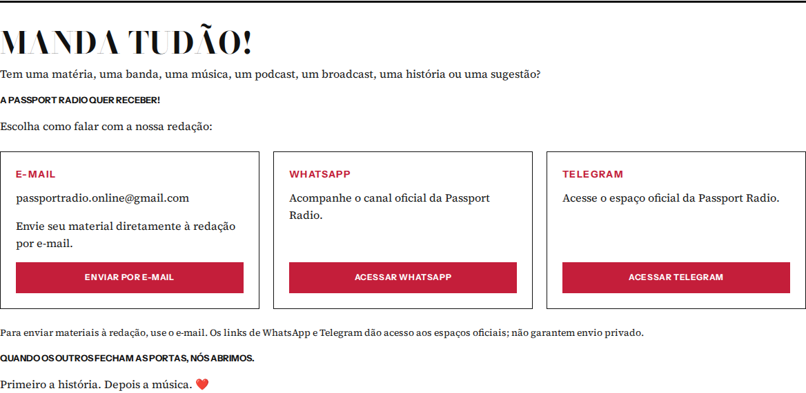
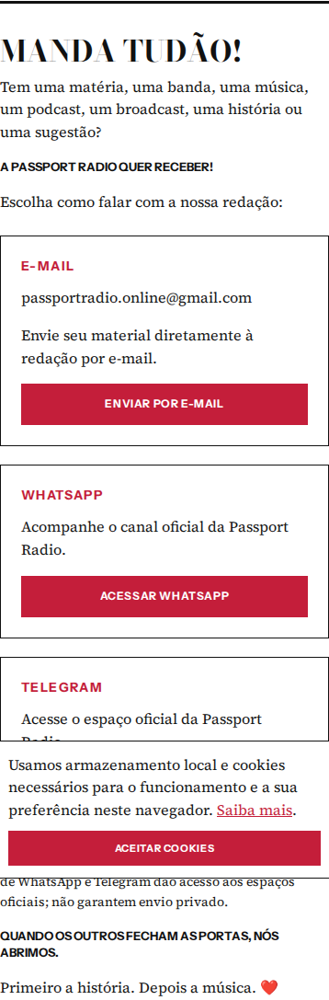

# Participações por contato direto

Decisão do proprietário: formulário e painel aposentados. Sem recuperação de senha ou sistema substituto.

- Público: três contatos, sem DOM de formulário ou scripts de autenticação/envio.
- E-mail: mailto:passportradio.online@gmail.com. O botão abre o cliente do visitante; não foi enviado e-mail de teste.
- WhatsApp/Telegram: URLs oficiais exatas. Nenhuma promessa de envio privado.
- Produção: blog-aberto v7 devolve HTTP 410 em submit e todas as ações admin antes de autenticação/acesso a dados. public-controls fecha envios/anexos, preserva comentários.
- Cron participe-notifications: active=false. Job e histórico mantidos. Nenhum secret ou integração Resend alterado.
- Bee Gees e QUALQUER COISA: status recebida. Duas notificações pending preservadas.
- Interface pública/painel: dependem do merge da PR #542; não foi feito merge.

## Evidências

[Execução Chromium](https://github.com/7-Seas-Global-and-Hafen-Consolidators/passport-radio/actions/runs/38094512408), desktop 1440 e celular 390, com DOM real e scripts compartilhados: sem formulário, URLs corretas, sem overflow, fotografia original carregada, painel informativo sem login/scripts. Banner de cookies existente permanece no celular.

Três testes Node focados passaram. A antiga suíte de submissões autenticadas foi preservada como arquivo, substituída no build pelo teste do encerramento e dos contatos. Outros checks existentes permanecem.
